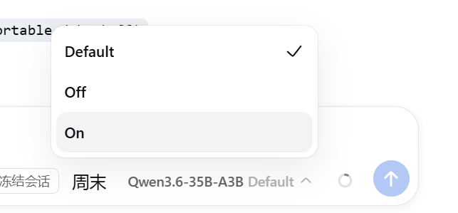

# dsh-llm-openai-completions

> ✅ **Ressuscité en 0.3.0 (2026-10-05).** La prise de contrôle du transport est de retour avec de vraies fonctions que pi-ai ne peut pas offrir : envoi véritablement multimodal (image/audio/vidéo/PDF) avec une porte dure de modalité, une couture de source de prompt `llmOpenaiCompletions` pour les consommateurs de type dsh-promptbook, des clés via le service de credentials et une compatibilité dynamique de tous les rc de `0.1.0-rc.8` à `0.2.1-rc.4`. L'architecture de l'ère `settings.get` est retirée — le jugement est `enabled && providers.includes(route)` (appartenance purement manuelle : la case à cocher par route est la vérité) et l'interrupteur vit dans la propre section de réglages de ce plugin. Surfaces de contrat : [AGENTS.md](./AGENTS.md).

**Positionnement** : ressuscité comme backend de court-circuit que dsh-thinking-levels peut actionner — parlant **les trois formats API courants** selon la déclaration `api` de chaque route (OpenAI Chat Completions · Anthropic Messages · OpenAI Responses), construit principalement pour le multimodal de Xiaomi MiMo : envoi réel audio/vidéo/PDF.

## Langues du README / 说明文档

[English](./README.md) · [中文](./README.zh.md) · [日本語](./README.ja.md) · [한국어](./README.ko.md) · [Deutsch](./README.de.md) · [Español](./README.es.md) · Français · [Italiano](./README.it.md) · [Русский](./README.ru.md)

Guides d'installation : [EN](./INSTALL.md) · [中文](./INSTALL.zh.md) · [日本語](./INSTALL.ja.md) · [한국어](./INSTALL.ko.md) · [DE](./INSTALL.de.md) · [ES](./INSTALL.es.md) · [FR](./INSTALL.fr.md) · [IT](./INSTALL.it.md) · [RU](./INSTALL.ru.md) — [Journal des modifications](./CHANGELOG.md)

**Prise de contrôle de transport compatible OpenAI-completions pour passerelles personnalisées** (vLLM / LM Studio / proxys OpenAI auto-hébergés) : le plugin court-circuite la cascade `llm/stream` pour les routes prises et les sert avec un comportement qui ne devine jamais — le plan de données (baseURL / models / `reasoningEfforts` / `compat` / `input`) reste dans **llm-pi-ai**, lu en direct via `settings.describe()`.

- `system` est **toujours** `role: "system"` — une passerelle personnalisée ne reçoit jamais `developer`, donc l'erreur 400 `Unexpected message role` disparaît même quand le thinking est activé (le `detectCompat` de pi-ai met `supportsDeveloperRole: true` par défaut pour les URL non standard, ce qui casse chaque passerelle personnalisée dès qu'une table `reasoningEfforts` marque le modèle comme raisonneur).
- Le thinking est piloté par le `compat.thinkingFormat` du modèle :
  - modèles à bascule (table `reasoningEfforts`, sans `supportsReasoningEffort`) → toujours `chat_template_kwargs.enable_thinking` (+ preserve), quel que soit le format configuré — car c'est la seule chose que les modèles Qwen3 de vLLM nu honorent
  - `qwen` → `enable_thinking: boolean` de premier niveau (pas de `reasoning_effort`, pas de budget)
  - `qwen-chat-template` → `chat_template_kwargs.enable_thinking` (+ preserve)
  - à capacité effort → passage direct de `reasoning_effort` (style Qwen3.8)
- Le côté réception scinde le contenu `</think>` style Qwen3 (vLLM rend le thinking dans `content` sans champ `reasoning_content`) en un bloc de raisonnement, et lit `reasoning_content` / `reasoning` / `reasoning_text`.
- Aucun `thinking_budget` n'est envoyé (délibéré : éviter les surprises de troncature).

## 🎉 0.3.0 — Envoi multimodal véritable avec porte dure de modalité

Le court-circuit consomme la cascade **avant** que l'hôte ne projette les blocs file en poignées de texte — les médias arrivent donc structurels et sont codés pour le fil : aucun correctif d'hôte, aucune reconstruction de poignée :

- **image** → parties `image_url` data-URI (nombre et ordre multi-images préservés, texte entrelacé dans l'ordre source)
- **audio** → parties `input_audio` (base64 + format)
- **vidéo** → parties `video_url` data-URI (plafond en ligne de 20 Mo)
- **PDF** → parties `file` OpenAI
- **Porte dure de modalité** : chaque bloc média de l'historique complet est vérifié contre la déclaration `input` llm-pi-ai du modèle avant toute lecture ou envoi ; une modalité non déclarée est refusée à voix haute (`INVALID_REQUEST`, en nommant la modalité) au lieu d'être dégradée silencieusement en texte.
- Les appels one-shot (`session-title`) retirent les blocs média et ne pensent jamais.
- Les octets viennent du service de pièces jointes (`readImage` / `readFileStream`) ; les modèles non vision rejettent toujours les images à voix haute (`UNSUPPORTED_CONTENT`).

## 🎉 0.3.0 — La couture de source de prompt `llmOpenaiCompletions`

`ctx.provide("llmOpenaiCompletions", { listHostedModels, registerPromptSource })` — le même contrat que dsh-llm-mimo expose sous `llmMimo`, pour les consommateurs de type dsh-promptbook : remplacer le prompt système et les descriptions d'outils **réellement expédiés** par `(provider, model)`, de façon déterministe (sûr pour le cache), texte seul (jamais `name`/`parameters`), comportement zéro sans source enregistrée. Garantie de portée : consulté uniquement dans le dispatch des routes prises. Contrat complet : [AGENTS.md §1](./AGENTS.md).

## Trois faces de fil (par route `api`)

| face | endpoint | auth | thinking | modalités |
|---|---|---|---|---|
| `openai-completions` (défaut) | `{base}/chat/completions` | Bearer | matrice thinkingFormat | image/audio/vidéo/PDF |
| `anthropic-messages` | `{base}/v1/messages` | `x-api-key` + en-tête de version | off/one-shot → disabled | **image seulement** |
| `openai-responses` | `{base}/responses` | Bearer | `reasoning.effort` (pli honnête) | image/audio/vidéo/PDF |

- Toutes les faces : `max_tokens` = valeur de la requête → ligne du modèle → défaut de la route → 8192 ; le message system initial est extrait vers le canal system de la face et retiré de la liste.
- Discipline d'appariement anthropic : tool_use/tool_result doivent s'apparier (historique cassé = `INVALID_REQUEST` à voix haute) ; le thinking de l'assistant n'est pas rejoué (aucun champ de signature dans le harness — strictement plus faible que la face chat).
- Limites responses : `stop` abandonné (pas d'orthographe Responses) ; niveaux de reasoning pliés honnêtement ; calibration par sonde contre de vrais endpoints MiMo à venir.

## Jugement de prise de contrôle (source de vérité unique)

```
takeover(route) = section.enabled === true
                  && section.providers.includes(route)
```

```yaml
# ~/.dsh/profiles/web/cordis.patch.yml (ou Réglages → Plugins → dsh-llm-openai-completions)
llm-openai-completions:
  enabled: true
  providers:        # la liste de prise de contrôle — la vérité unique (voir ci-dessous)
    - local-35b
```

- L'interrupteur et la liste de prise de contrôle vivent dans la **propre section de réglages de ce plugin** (`.volatile()` — modifiable à l'exécution, formulaire généré par l'hôte).
- **dsh-thinking-levels actionne les deux champs** : son interrupteur `takeover` reflète `{enabled}` dans cette section, et la case à cocher de prise de contrôle par route de son panneau de modèles écrit `providers` directement — la case est la vérité ; le dispatch, `listHostedModels` et le filtrage de la couche de contrôle lisent le même ensemble.
- Désactiver l'interrupteur (ou désinstaller le plugin) retombe sur pi-ai à l'identique — aucun enregistrement d'adaptateur à défaire.
- Votre configuration llm-pi-ai reste telle quelle (une configuration partagée ; cet adaptateur ne fait que la lire — table complète des champs : [docs/settings-spec.md](docs/settings-spec.md), contrat de prise de contrôle : [docs/takeover-spec.md](docs/takeover-spec.md)) :

```yaml
llm-pi-ai:
  providers:
    local-35b:
      api: openai-completions
      baseURL: http://192.168.100.242:8200/v1
      models:
        - id: Qwen3.6-35B-A3B
          reasoningEfforts: { off: null, high: 'high' }
          compat:
            thinkingFormat: qwen        # enable_thinking seul, pas de reasoning_effort
```

## Aperçu

Capture en direct — **alimenté ensemble avec dsh-thinking-levels** : le menu déroulant de niveau « pensable » du modèle personnalisé (Par défaut/Désactivé/Activé). Il démontre la chaîne détection → prise de contrôle :

<figure>
  
  <figcaption>Carte de capacités + chaîne de prise de contrôle avec dsh-thinking-levels : une configuration llm-pi-ai partagée — la <strong>carte détecte</strong> (écrit input/reasoningEfforts/compat), le <strong>transport prend le fil</strong> (envoie enable_thinking / reasoning_effort selon compat.thinkingFormat).</figcaption>
</figure>

## Installation

Compatibilité hôte : **chaque rc de `0.1.0-rc.8` à `0.2.1-rc.4`**, conditionnel par version dans le code (faces de settings détectées par forme, un shim `ToolCallId`/`CallId`, résolution de clé credentials → environnement de lancement → `process.env`). Toutes les voies dans le [guide d'installation](./INSTALL.fr.md) :

```bash
# npm (recommandé)
dsh plugin --profile web add dsh-llm-openai-completions -w
# tgz local
dsh plugin --profile web add /chemin/vers/dsh-llm-openai-completions-0.3.0.tgz -w
dsh web
```

## Limitations connues

- **Le support PDF dépend du point de terminaison** (MiMo chat le refuse carrément ; certains relais l'acceptent) — la déclaration `input` est une affirmation de capacité ; vérifiez votre endpoint avant de déclarer `pdf`.
- **Les pièces jointes non multimédias** (p. ex. `.txt`) n'ont pas de forme de fil inter-passerelles ; sur les routes prises elles se dégradent en espace réservé textuel (le contenu reste accessible via les outils de fichiers).
- **Pas de `thinking_budget`** (délibéré).
- Le **sélecteur** de niveau de thinking vient toujours des métadonnées de raisonnement du modèle (llm-pi-ai + dsh-thinking-levels) ; ce transport ne contrôle que le comportement du fil.
- Redémarrez `dsh web` après l'installation ; l'écouteur de prise de contrôle se compose au démarrage.

## Développement

```bash
npm install
npm run typecheck   # tsc --noEmit
npm test            # vitest (config / identify / serialize / sse / translate / prompt-source / version-conditional)
npm run build       # tsc → lib/
node scripts/audit-host-faces.mjs   # audit des surfaces de dépendances 15-rc
```

## Proposition amont

Ce plugin sert aussi d'implémentation de référence pour les brèches de compatibilité llm-pi-ai / pi-ai : les URL personnalisées devraient avoir `supportsDeveloperRole: false` par défaut, le côté réception devrait scinder le contenu `</think>`, et `compat` devrait exposer `supportsDeveloperRole` pour les passerelles qui le soutiennent vraiment — et la couche de projection de l'hôte pourrait cultiver la même porte de blocs file consciente des capacités que ce plugin applique par route.
