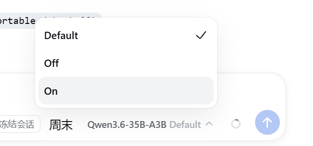

# dsh-llm-openai-completions

> ✅ **Revivido como 0.3.0 (2026-10-05).** O takeover do transporte voltou com recursos reais que o pi-ai não oferece: envio verdadeiramente multimodal (imagem/áudio/vídeo/PDF) com uma porta dura de modalidade, uma costura de fonte de prompt `llmOpenaiCompletions` para consumidores do tipo dsh-promptbook, chaves via serviço de credenciais e compatibilidade dinâmica com todos os rc entre `0.1.0-rc.8` – `0.2.1-rc.4`. A arquitetura da era `settings.get` foi aposentada — o julgamento é `enabled && providers.includes(route)` (pertência puramente manual: a caixa por rota é a verdade) e o interruptor vive na própria seção de ajustes deste plugin. Superfícies de contrato: [AGENTS.md](./AGENTS.md).

**Posicionamento**: revivido como um backend de curto-circuito que o dsh-thinking-levels pode acionar — falando **os três formatos de API mainstream** conforme a declaração `api` de cada rota (OpenAI Chat Completions · Anthropic Messages · OpenAI Responses), construído principalmente para o multimodal do Xiaomi MiMo: envio real de áudio/vídeo/PDF.

## Idiomas do README / 说明文档

[English](./README.md) · [中文](./README.zh.md) · [日本語](./README.ja.md) · [한국어](./README.ko.md) · [Deutsch](./README.de.md) · [Español](./README.es.md) · [Français](./README.fr.md) · [Italiano](./README.it.md) · [Русский](./README.ru.md) · Português

Guias de instalação: [EN](./INSTALL.md) · [中文](./INSTALL.zh.md) · [日本語](./INSTALL.ja.md) · [한국어](./INSTALL.ko.md) · [DE](./INSTALL.de.md) · [ES](./INSTALL.es.md) · [FR](./INSTALL.fr.md) · [IT](./INSTALL.it.md) · [RU](./INSTALL.ru.md) · PT — [Registro de mudanças](./CHANGELOG.md)

**Takeover de transporte compatível com OpenAI-completions para gateways personalizados** (vLLM / LM Studio / proxies OpenAI auto-hospedados): o plugin fecha em curto-circuito a cascata `llm/stream` para as rotas assumidas e as atende com um comportamento que nunca adivinha — o plano de dados (baseURL / models / `reasoningEfforts` / `compat` / `input`) permanece no **llm-pi-ai**, lido ao vivo via `settings.describe()`.

- `system` é **sempre** `role: "system"` — um gateway personalizado nunca recebe `developer`, então o 400 `Unexpected message role` desaparece mesmo com thinking ativado (o `detectCompat` do pi-ai coloca `supportsDeveloperRole: true` por padrão para URLs não padrão, o que quebra todo gateway personalizado assim que uma tabela `reasoningEfforts` marca o modelo como de raciocínio).
- O thinking é dirigido pelo `compat.thinkingFormat` do modelo:
  - modelos de toggle (tabela `reasoningEfforts`, sem `supportsReasoningEffort`) → sempre `chat_template_kwargs.enable_thinking` (+ preserve), independentemente do formato configurado — porque é o único que as templates Qwen3 de um vLLM nu honram
  - `qwen` → `enable_thinking: boolean` de nível superior (sem `reasoning_effort`, sem orçamento)
  - `qwen-chat-template` → `chat_template_kwargs.enable_thinking` (+ preserve)
  - com capacidade de effort → passe direto de `reasoning_effort` (estilo Qwen3.8)
- O lado de recepção divide o conteúdo `</think>` estilo Qwen3 (o vLLM renderiza o thinking em `content` sem campo `reasoning_content`) em um bloco de raciocínio, e lê `reasoning_content` / `reasoning` / `reasoning_text`.
- `thinking_budget` não é enviado (deliberado: evitar surpresas de truncamento).

## 🎉 0.3.0 — Envio multimodal verdadeiro com porta dura de modalidade

O curto-circuito consome a cascada **antes** de o host projetar os blocos file em manipuladores de texto, então a mídia chega estrutural e é codificada para o cabo — sem remendo de host, sem reconstrução de manipuladores:

- **imagem** → partes `image_url` data-URI (contagem e ordem multi-imagem preservados, texto intercalado na ordem de origem)
- **áudio** → partes `input_audio` (base64 + formato)
- **vídeo** → partes `video_url` data-URI (limite de 20 MB na linha)
- **PDF** → partes `file` do OpenAI
- **Porta dura de modalidade**: cada bloco de mídia do histórico completo é verificado contra a declaração `input` do llm-pi-ai do modelo antes de ler ou enviar qualquer coisa; uma modalidade não declarada é recusada em voz alta (`INVALID_REQUEST`, nomeando a modalidade) em vez de degradar silenciosamente para texto.
- As chamadas de uma só vez (`session-title`) removem os blocos de mídia e nunca pensam.
- Os bytes vêm do serviço de anexos (`readImage` / `readFileStream`); modelos sem visão continuam recusando imagens em voz alta (`UNSUPPORTED_CONTENT`).

## 🎉 0.3.0 — A costura de fonte de prompt `llmOpenaiCompletions`

`ctx.provide("llmOpenaiCompletions", { listHostedModels, registerPromptSource })` — o mesmo contrato que o dsh-llm-mimo expõe como `llmMimo`, para consumidores do tipo dsh-promptbook: substituir o prompt de sistema e as descrições de ferramentas **realmente despachadas** por `(provider, model)`, deterministicamente (seguro para cache), só texto (nunca `name`/`parameters`), comportamento zero sem fonte registrada. Garantia de escopo: consultada apenas em rotas assumidas. Contrato completo: [AGENTS.md §1](./AGENTS.md).

## Três faces de cabo (por `api` de rota)

| face | endpoint | auth | thinking | modalidades |
|---|---|---|---|---|
| `openai-completions` (padrão) | `{base}/chat/completions` | Bearer | matriz thinkingFormat | imagem/áudio/vídeo/PDF |
| `anthropic-messages` | `{base}/v1/messages` | `x-api-key` + header de versão | off/uma vez → disabled | **só imagem** |
| `openai-responses` | `{base}/responses` | Bearer | `reasoning.effort` (dobrada honesta) | imagem/áudio/vídeo/PDF |

- Todas as faces: `max_tokens` = valor da requisição → linha do modelo → padrão da rota → 8192; a mensagem system inicial é extraída para o canal system da face e removida da lista.
- Disciplina de pareamento anthropic: tool_use/tool_result precisam estar pareados (histórico quebrado = `INVALID_REQUEST` em voz alta); o thinking do assistente não é reproduzido (sem campo de assinatura no harness — estritamente mais fraco que a face chat).
- Limites do responses: `stop` descartado (sem grafia no Responses); níveis de reasoning dobrados honestamente; calibração por sonda contra endpoints MiMo reais pendente.

## Julgamento de takeover (única fonte de verdade)

```
takeover(route) = section.enabled === true
                  && section.providers.includes(route)
```

```yaml
# ~/.dsh/profiles/web/cordis.patch.yml (ou Ajustes → Plugins → dsh-llm-openai-completions)
llm-openai-completions:
  enabled: true
  providers:        # a lista de takeover — a única verdade (veja abaixo)
    - local-35b
```

- O interruptor e a lista de takeover vivem na **própria seção de ajustes deste plugin** (`.volatile()` — editável em tempo de execução, formulário gerado pelo host).
- **O dsh-thinking-levels aciona ambos os campos**: seu interruptor `takeover` reflete `{enabled}` nesta seção, e a caixa de takeover por rota no painel de modelos dele escreve `providers` diretamente — a caixa é a verdade; o dispatch, o `listHostedModels` e o filtro da camada de controle leem o mesmo conjunto.
- Desligar o interruptor (ou desmontar o plugin) cai para o pi-ai sem mudanças — não há registro de adaptador a desfazer.
- Sua configuração llm-pi-ai fica como está (uma configuração compartilhada; este adaptador só a lê — tabela completa de campos: [docs/settings-spec.md](docs/settings-spec.md), contrato de takeover: [docs/takeover-spec.md](docs/takeover-spec.md)):

```yaml
llm-pi-ai:
  providers:
    local-35b:
      api: openai-completions
      baseURL: http://192.168.100.242:8200/v1
      models:
        - id: Qwen3.6-35B-A3B
          reasoningEfforts: { off: null, high: 'high' }
          compat:
            thinkingFormat: qwen        # só enable_thinking, sem reasoning_effort
```

## Prévia

Captura ao vivo — **operado junto com o dsh-thinking-levels**: o menu suspenso de nível "pensável" do modelo personalizado (Padrão/Desligado/Ligado). Demonstra a cadeia detecção → takeover:

<figure>
  
  <figcaption>Cartão de capacidades + cadeia de takeover com o dsh-thinking-levels: uma configuração llm-pi-ai compartilhada — o <strong>cartão detecta</strong> (escreve input/reasoningEfforts/compat), o <strong>transporte assume o cabo</strong> (envia enable_thinking / reasoning_effort conforme compat.thinkingFormat).</figcaption>
</figure>

## Instalação

Compatibilidade de host: **cada rc de `0.1.0-rc.8` até `0.2.1-rc.4`**, condicional por versão no código (faces de settings detectadas por forma, um shim `ToolCallId`/`CallId`, resolução de chave credentials → ambiente de lançamento → `process.env`). Todos os caminhos no [guia de instalação](./INSTALL.pt.md):

```bash
# npm (recomendado)
dsh plugin --profile web add dsh-llm-openai-completions -w
# tgz local
dsh plugin --profile web add /caminho/para/dsh-llm-openai-completions-0.3.0.tgz -w
dsh web
```

## Limitações conhecidas

- **O suporte a PDF depende do endpoint** (o chat MiMo recusa de plano; alguns relays aceitam) — a declaração `input` é uma afirmação de capacidade; verifique seu endpoint antes de declarar `pdf`.
- **Anexos de arquivos não multimídia** (por exemplo `.txt`) não têm forma de cabo atravessando gateways; em rotas assumidas degradam para um marcador de texto (o conteúdo continua acessível pelas ferramentas de arquivos).
- **Sem `thinking_budget`** (deliberado).
- O **seletor** de nível de thinking continua vindo dos metadados de raciocínio do modelo (llm-pi-ai + dsh-thinking-levels); este transporte só comanda o comportamento do cabo.
- Reinicie o `dsh web` após instalar; o ouvinte de takeover se compõe na partida.

## Desenvolvimento

```bash
npm install
npm run typecheck   # tsc --noEmit
npm test            # vitest (config / identify / serialize / sse / translate / prompt-source / version-conditional)
npm run build       # tsc → lib/
node scripts/audit-host-faces.mjs   # auditoria das superfícies de dependência 15-rc
```

## Proposta rio acima

Este plugin também serve como implementação de referência para as lacunas de compatibilidade do llm-pi-ai / pi-ai: URLs personalizadas deveriam ter `supportsDeveloperRole: false` por padrão, o lado de recepção deveria dividir o conteúdo `</think>`, e `compat` deveria expor `supportsDeveloperRole` para gateways que realmente o suportam — e a camada de projeção do host poderia cultivar a mesma porta de blocos file consciente de capacidades que este plugin aplica por rota.
